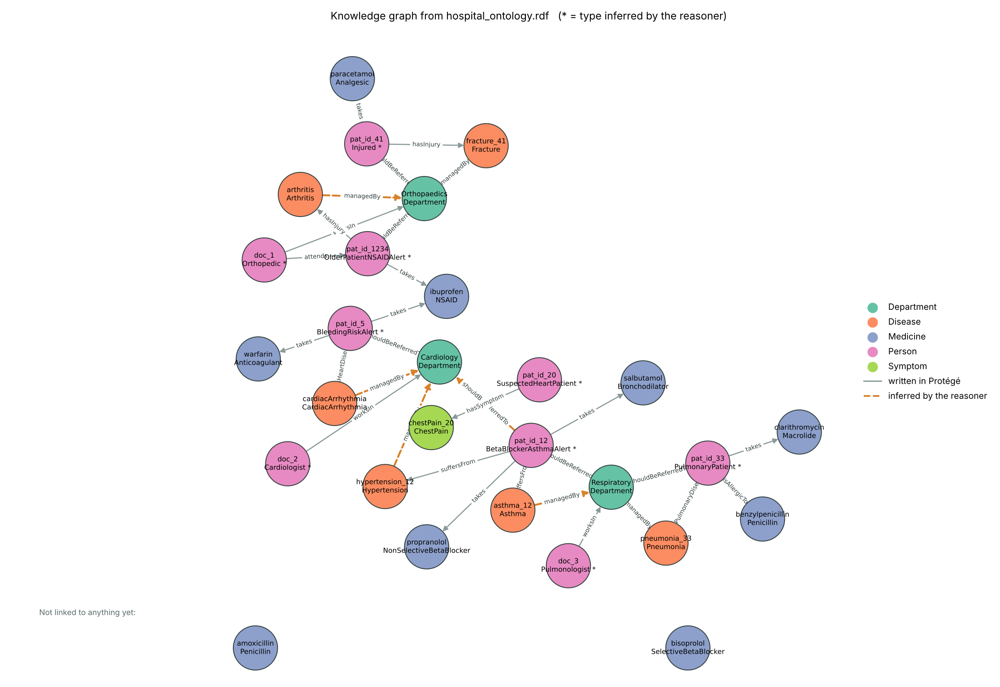

# Ontology Testing: from a Protégé ontology to modern AI

You've built an ontology in Protégé and saved it as `.rdf`. What now? This notebook takes that file and uses it the way ontologies are used in AI today. It runs a reasoner, turns the ontology into a knowledge graph, grounds an LLM (Llama) in it, and uses it as a safety check on what the LLM suggests.

It works with **any** OWL ontology saved from Protégé. A sample hospital ontology is included if you don't have one yet.

## What it shows, using the sample hospital ontology

- **The reasoner adds 31 facts to the 53 written by hand.** Nobody typed that `pat_id_12` has both heart and lung disease, or that they should be referred to Cardiology and Respiratory. HermiT worked it out from the class definitions.
- **An LLM on its own guesses, an LLM with the ontology checks.** Asked "Can pat_id_33 be given amoxicillin?", Llama alone has no way to know the patient's record. With the ontology it receives only the 13 relevant facts out of 84. These include the penicillin allergy and the fact that amoxicillin is a penicillin, and it must cite each one.
- **The reasoner has the last word.** When Llama suggests a medicine from the diagnosis alone, the suggestion is added to the ontology and checked against every rule. A penicillin for a penicillin-allergic patient makes the ontology inconsistent and is **blocked**. Warfarin for a 71-year-old already on ibuprofen is allowed but raises a **bleeding-risk alert**.

## The steps

| Step | What happens | Used in practice for |
|---|---|---|
| 1. Load | Reads your `.rdf` and prints the class hierarchy | Any OWL tool |
| 2. Reason | HermiT adds every fact that follows from your definitions | Clinical terminologies such as SNOMED CT |
| 3. Knowledge graph | Individuals become nodes, properties become links, inferred links in orange | Search engines, enterprise data platforms |
| 4. GraphRAG | Llama answers the same question with and without the ontology, citing facts like `[F12]` | Grounding LLMs to stop made-up answers |
| 5. Guardrail | Llama suggests a new fact, the reasoner accepts, flags or blocks it | AI safety checks |

## Run it

1. Click **Open in Colab** above.
2. Get a free API key at [console.groq.com](https://console.groq.com). No card is needed. Groq runs Meta's open Llama models.
3. In Colab, click the **key icon** on the left, add a secret called `GROQ_API_KEY` with your key, and switch on **Notebook access**.
4. Run the cells from the top. Steps 1 to 3 work even without a key.

To use your own ontology, save it in Protégé with **File → Save as… → RDF/XML Syntax**, drag it into Colab's Files panel and set `MY_FILE = "your_file.rdf"` in Step 1.

## The sample ontology

`ontologies/hospital_ontology.rdf` extends a classic doctor and patient teaching example. It has 49 classes, 12 object properties and 28 individuals.

- **Defined classes**, such as `HeartPatient = Patient and suffersFrom some HeartDisease`, so the reasoner can classify patients.
- **A property chain**, where `shouldBeReferredTo = suffersFrom then managedBy`, routes patients to departments.
- **Prescription alerts**, which flag a non-selective beta-blocker with asthma, an anticoagulant with an NSAID, and an NSAID at age 65 or over.
- **A hard safety rule**, under which a penicillin-allergic patient may only take medicines that are not penicillins.

All patients are fictional, and the drug rules are simplified teaching examples, not medical advice.

## Built with

[Owlready2](https://owlready2.readthedocs.io) and the HermiT reasoner, [NetworkX](https://networkx.org), and Llama 3.3 70B through the [Groq](https://groq.com) API.

---

Made by [Thashmika Bandara](https://github.com/Thashmikab). If you found it useful, a ⭐ helps others find it.
